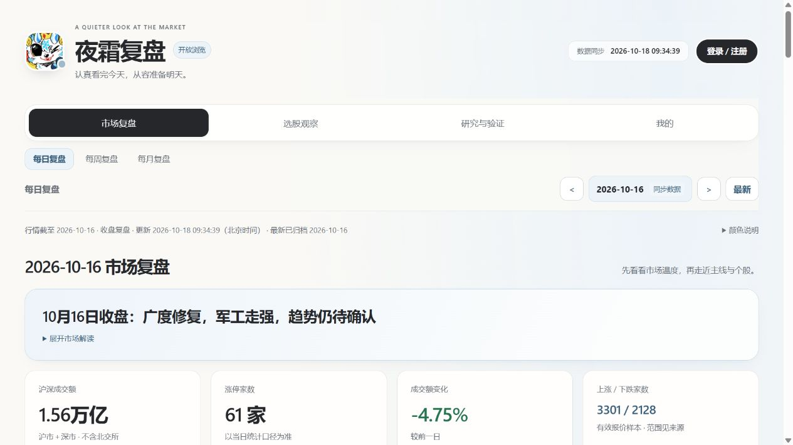
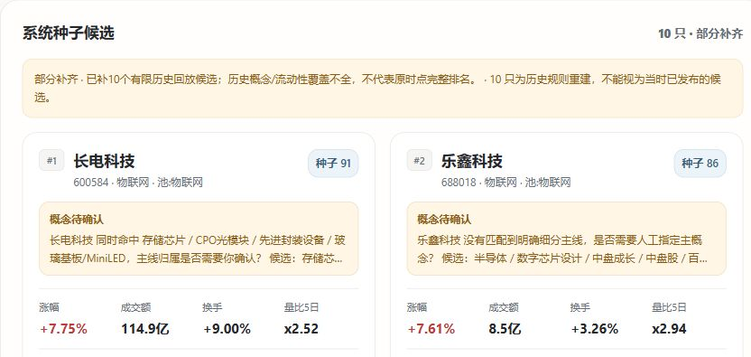
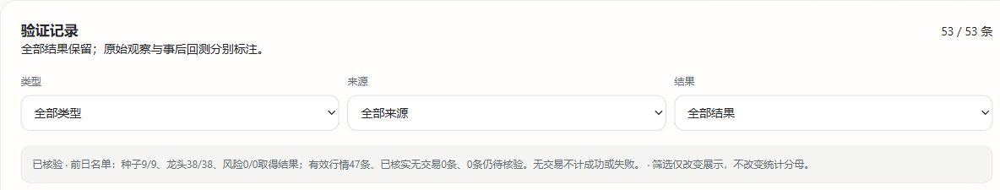
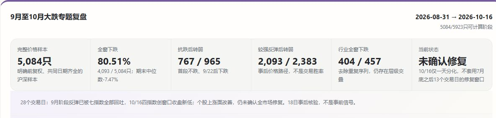

# 夜霜 A 股复盘

**FrostyNight A-share Review**

**发现值得跟踪的种子，回访每一次判断，读懂大跌与修复。**

面向 A 股投资者的收盘复盘工作区。将市场概览、板块与个股观察、预测验证、人工研究专题放在一起，让每天的复盘可以接着昨天继续，也能回到历史日期重新审视当时的判断。

[访问夜霜 A 股复盘](https://frostynight.top/stocks/)

*2026-10-16 收盘复盘页面，页面更新于 2026-10-18；行情日期与更新时间分别展示。*

## 种子推荐：找到值得继续研究的候选

收盘后查看系统种子候选，结合所属板块、行情表现、观察说明与风险标签，快速了解下一步值得深入阅读的线索。点击个股进入详情，将候选放回当天的市场环境中理解；也可以从「选股观察」按名称、代码、板块及风险标签查找。

候选用于建立后续观察清单。页面标明原始记录与历史重建的区别；当天没有候选或资料待补时，也会展示相应状态。是否形成进一步判断，需要结合后续信息与自身研究。

*2026-09-18 历史候选页面。图中为历史规则重建、部分补齐的记录，不能视为当日已发布的推荐，也不是当前推荐。*

## 预测验证：让观察接受后续行情检验

把前一日的观察与后续表现对应起来，回看种子、龙头、风险提示和连续样本的验证记录。通过类型、来源与结果筛选，找到值得复盘的成功案例，也能检查失败、未达标、未触发以及待验证的记录。

查看一条结果时，可以继续追溯原观察及对应日期，辨别判断兑现到哪一步、哪些信息仍然不足。原始观察、补录与事后回测分别标注；价格达标、判断成立和实际交易收益各有不同含义，历史结果以页面披露的范围与口径阅读。

*2026-09-18 验证记录页面。本示例展示历史重建与事后回测的核验，不代表事前预测成绩或实盘收益。*

## 大跌专题：回看压力中的分化与修复

市场大跌之后，指数反弹并不能回答每一只股票的处境。人工整理的公开研究专题将下跌、反抽与后续修复放在共同窗口内，结合板块表现和个股样本，比较抗跌后延续、抗跌后转弱、较强反弹与弱修复等不同路径。

专题保留研究窗口、资料来源、样本覆盖、反例及数据限制，帮助读者理解市场阶段、检查原有判断、积累下一次复盘的参照。这里展示的是经过整理的历史分析与观察摘要，不提供自动抄底预警或底部预测。

*公开人工专题摘要，研究窗口为 2026-08-31 至 2026-10-16，2026-10-18 事后核验。统计描述历史价格路径，不是交易胜率或底部信号。*

## 从市场全景，走到自己的复盘

- **日、周、月连续回看**：从单日行情到阶段变化，按报告日期浏览市场结论、板块主线与公开专题。
- **板块与个股相互参照**：从板块查看成员，也能按证券查找历次公开观察，减少在零散页面间来回搜索。
- **价格与成交放在一起看**：个股详情按需载入截至报告日期的近期日 K、成交量和逐日行情，保留来源与覆盖说明。
- **保存个人关注与操作复盘**：登录后维护自己的观察记录，资料按账户隔离；桌面和手机都可浏览。

## 开始使用

1. 打开「市场复盘」，选择日期，先看市场与板块概览。
2. 阅读种子候选或公开观察，进入个股详情核对行情与历史记录。
3. 到「研究与验证」回访判断结果，或阅读大跌等市场专题。
4. 需要保存自己的观察时，登录后进入「我的」。

公开市场页面可直接浏览；个人功能需要登录，新用户通过邀请码注册。各期内容以页面标明的数据日期、完整性与可用状态为准，截图展示具体历史页面。

## 关于本仓库

本仓库用于产品介绍与界面展示。产品源码、选股规则、评分参数、策略研究方案、内部研究记录和账户数据保持私有。
